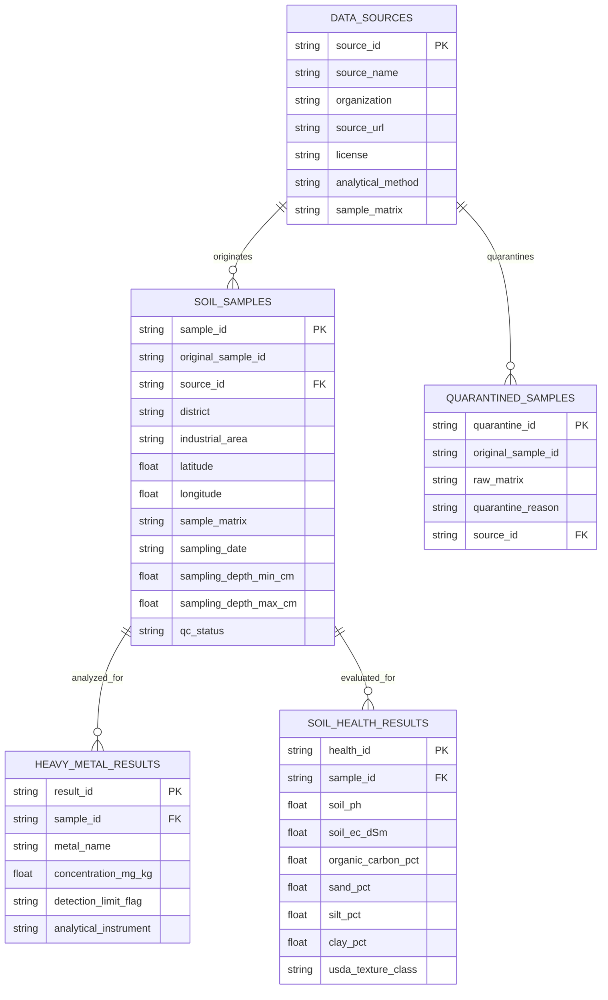

# Tamil Nadu SoilWatch — Geochemical Data Dictionary & Schema Specification

This document details the normalized relational and Parquet schemas implemented in the Tamil Nadu SoilWatch platform. All datasets adhere to strict scientific governance: no silent zero-imputation, distinct separation of soil vs. non-soil matrices, and mandatory provenance citations.

---

## 1. Relational & Parquet Architecture Overview

---

## 2. Table Specifications

### 2.1 `soil_samples`
*Stores georeferenced metadata for authentic topsoil sampling stations across Tamil Nadu.*

| Column Name | Data Type | Nullable | Units | Valid Range / Format | Description & Scientific Constraints |
| :--- | :--- | :---: | :--- | :--- | :--- |
| `sample_id` | `VARCHAR(64)` | No | — | `TN_SOIL_[0-9]{4,}` | Unique normalized station identifier (Primary Key). |
| `original_sample_id` | `VARCHAR(128)` | No | — | Text | Identifier from original laboratory notebook or publication. |
| `source_id` | `VARCHAR(64)` | No | — | Foreign Key | References `data_sources.source_id`. |
| `district` | `VARCHAR(64)` | No | — | Tamil Nadu District | e.g., `Ranipet`, `Cuddalore`, `Coimbatore`, `Tiruppur`, `Salem`, `Erode`, `Thoothukudi`, `Chennai`. |
| `industrial_area` | `VARCHAR(128)` | Yes | — | Industrial Corridor | Standardized corridor name (e.g., `Ranipet SIPCOT`, `Manali`). |
| `latitude` | `FLOAT64` | No | Decimal Deg | `8.0000` to `14.0000` | WGS84 latitude. Strict spatial assertion within Tamil Nadu boundary. |
| `longitude` | `FLOAT64` | No | Decimal Deg | `76.0000` to `81.0000` | WGS84 longitude. Strict spatial assertion within Tamil Nadu boundary. |
| `sample_matrix` | `VARCHAR(64)` | No | — | `Topsoil (0–15 cm)` | Strictly topsoil or subsoil. Non-soil matrices are rejected. |
| `sampling_date` | `DATE` / `VARCHAR` | Yes | ISO-8601 | `YYYY-MM-DD` | Date of field sample collection. |
| `sampling_depth_min_cm` | `FLOAT` | No | cm | `0.0` to `100.0` | Upper sampling horizon boundary (standard: `0.0`). |
| `sampling_depth_max_cm` | `FLOAT` | No | cm | `0.0` to `150.0` | Lower sampling horizon boundary (standard: `15.0`). |
| `qc_status` | `VARCHAR(32)` | No | — | `verified`, `incomplete`, `unverified_provenance` | Quality assurance audit status. |

---

### 2.2 `heavy_metal_results`
*Stores individual laboratory elemental measurements.*

> [!IMPORTANT]
> Missing values are stored explicitly as `NULL` (`NaN` in pandas/Parquet), NEVER as `0.00`. An absent measurement indicates no laboratory determination, not zero contamination.

| Column Name | Data Type | Nullable | Units | Reference Baseline ($B_n$) | CPCB Standard | Description |
| :--- | :--- | :---: | :--- | :---: | :---: | :--- |
| `result_id` | `VARCHAR(64)` | No | — | — | — | Unique measurement ID (`HM_[0-9]+`). |
| `sample_id` | `VARCHAR(64)` | No | — | — | — | Foreign Key to `soil_samples.sample_id`. |
| `metal_name` | `VARCHAR(32)` | No | — | — | — | `chromium`, `lead`, `cadmium`, `nickel`, `arsenic`, `copper`, `zinc`. |
| `concentration_mg_kg` | `FLOAT64` | Yes | `mg/kg` | — | — | Dry-weight metal concentration. |
| `detection_limit_flag` | `VARCHAR(16)` | Yes | — | `<LOD`, `DETECTED` | Indicator if measurement was below instrument limit of detection. |
| `analytical_instrument`| `VARCHAR(64)` | No | — | — | — | `ICP-MS`, `Flame AAS`, `Graphite Furnace AAS`, `ICP-OES`. |

#### Geochemical Baseline & Regulatory Threshold Reference
| Heavy Metal | Symbol | Background Baseline ($B_n$, mg/kg) | CPCB Guideline (mg/kg) | Canadian CCME Soil Quality (mg/kg) | Toxic Response Factor ($T_r$) |
| :--- | :---: | :---: | :---: | :---: | :---: |
| **Chromium** | Cr | 50.00 | 50.00 | 64.00 | 2.0 |
| **Lead** | Pb | 20.00 | 100.00 | 70.00 | 5.0 |
| **Cadmium** | Cd | 0.30 | 3.00 | 1.40 | 30.0 |
| **Nickel** | Ni | 20.00 | 50.00 | 45.00 | 5.0 |
| **Arsenic** | As | 10.00 | 20.00 | 12.00 | 10.0 |
| **Copper** | Cu | 45.00 | 100.00 | 63.00 | 5.0 |
| **Zinc** | Zn | 95.00 | 300.00 | 200.00 | 1.0 |

---

### 2.3 `soil_health_results`
*Agronomic and physicochemical properties influencing heavy-metal mobility and bioavailability.*

| Column Name | Data Type | Nullable | Units | Valid Range | Standard Analytical Protocol |
| :--- | :--- | :---: | :--- | :---: | :--- |
| `health_id` | `VARCHAR(64)` | No | — | — | Primary Key (`SH_[0-9]+`). |
| `sample_id` | `VARCHAR(64)` | No | — | — | Foreign Key to `soil_samples.sample_id`. |
| `soil_ph` | `FLOAT` | Yes | pH scale | `3.5` – `10.5` | 1:2.5 Soil-Water Suspension Electrode (IS 2720 Part 26). |
| `soil_ec_dSm` | `FLOAT` | Yes | dS/m | `0.01` – `15.0` | 1:2.5 Soil-Water Conductivity Cell at 25°C. |
| `organic_carbon_pct` | `FLOAT` | Yes | % | `0.01` – `8.00` | Walkley-Black Chromic Acid Wet Oxidation Method. |
| `sand_pct` | `FLOAT` | Yes | % | `0.0` – `100.0` | International Pipette / Hydrometer Sedimentation Method. |
| `silt_pct` | `FLOAT` | Yes | % | `0.0` – `100.0` | Hydrometer Sedimentation Method. |
| `clay_pct` | `FLOAT` | Yes | % | `0.0` – `100.0` | Hydrometer Sedimentation Method. |
| `usda_texture_class`| `VARCHAR(32)`| Yes | — | USDA Classes | Derived from USDA textural triangle (e.g. `Sandy Clay Loam`). |

---

### 2.4 `data_sources`
*Master register tracking institutional provenance and Open Data licenses.*

| Column Name | Data Type | Description |
| :--- | :--- | :--- |
| `source_id` | `VARCHAR(64)` | Primary Key (e.g., `SRC_TN_BENCHMARK_2024`, `SRC_TNPCB_SIPCOT_2023`). |
| `source_name` | `VARCHAR(255)`| Full published title or official government study name. |
| `organization` | `VARCHAR(255)`| Originating agency (e.g., TNPCB, CPCB, Anna University, NEERI). |
| `source_url` | `VARCHAR(512)`| Persistent DOI link or open-data portal URL. |
| `license` | `VARCHAR(64)` | Legal reuse license (e.g., `CC-BY-4.0`, `Open Government Data - India`). |
| `analytical_method` | `VARCHAR(128)`| Formal extraction protocol (`EPA 3050B`, `ISO 11466`). |
| `sample_matrix` | `VARCHAR(64)` | Tested matrix (`Topsoil (0–15 cm dry weight)`). |

---

### 2.5 `quarantined_samples`
*Segregated records rejected from topsoil baseline interpolation.*

| Column Name | Data Type | Description & Quarantine Policy |
| :--- | :--- | :--- |
| `quarantine_id` | `VARCHAR(64)` | Primary Key (`QNT_[0-9]+`). |
| `original_sample_id` | `VARCHAR(128)`| Raw identifier from original ingestion source. |
| `raw_matrix` | `VARCHAR(64)` | Rejected matrix: `Industrial Effluent`, `River Sediment`, `Foliar Tissue`, `Groundwater`. |
| `quarantine_reason` | `VARCHAR(255)`| Cause of exclusion: `Non-soil matrix`, `Invalid coordinates out of TN bounds`, `Dry weight not reported`. |
| `source_id` | `VARCHAR(64)` | Originating dataset source ID. |

